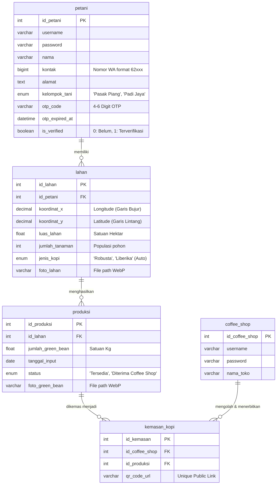
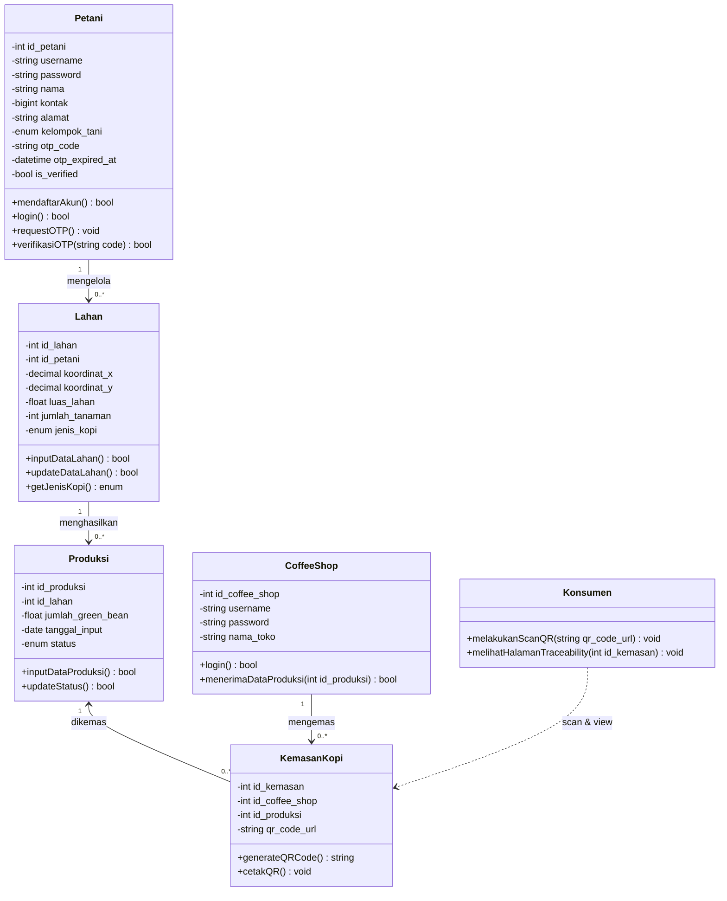
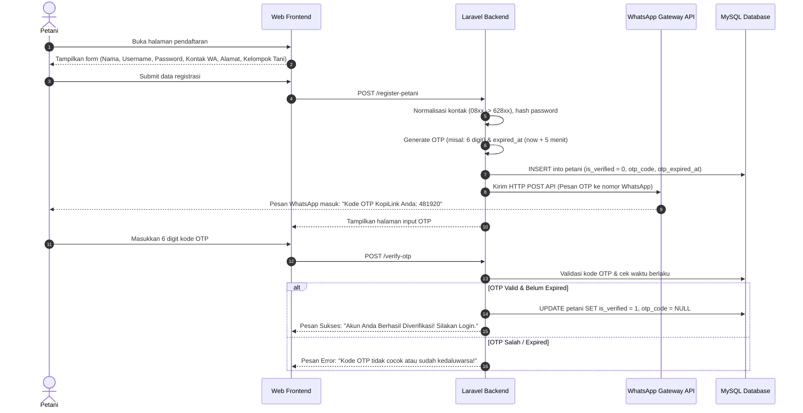
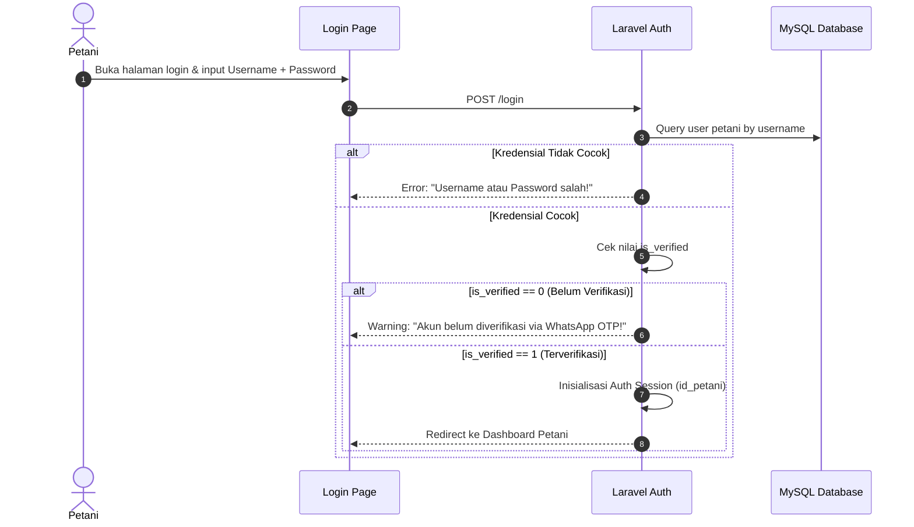
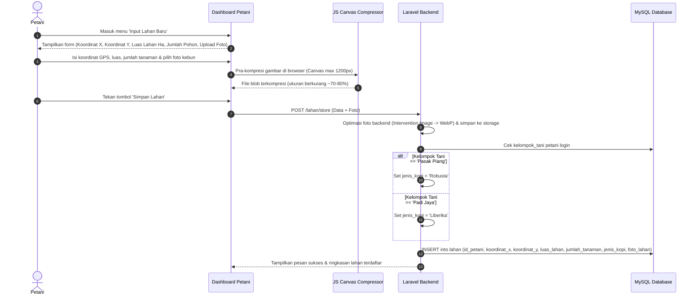
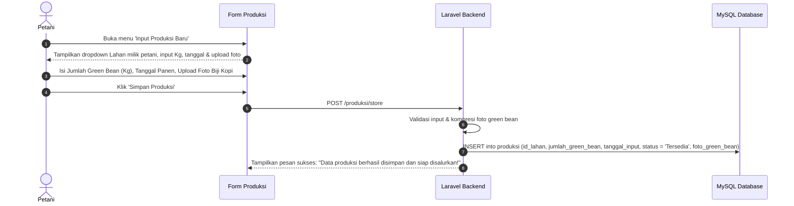
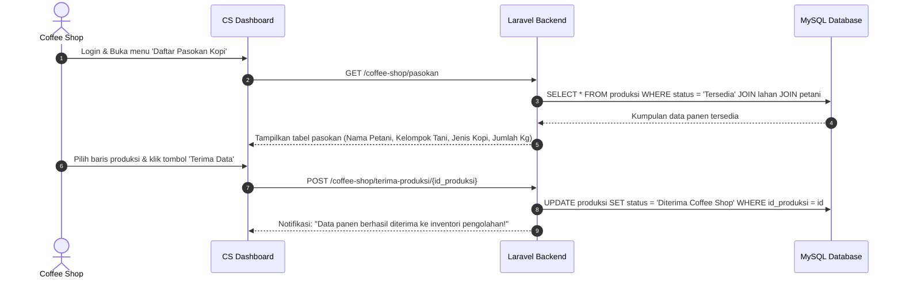
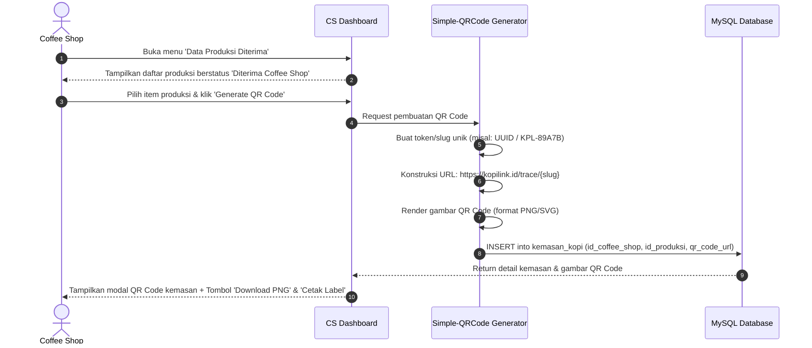
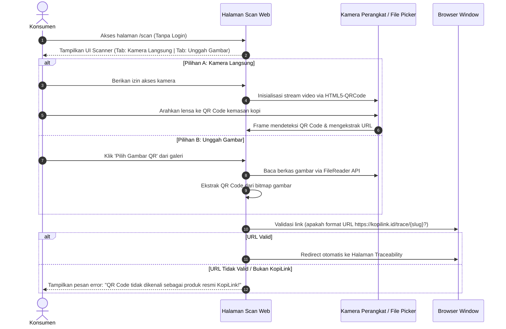
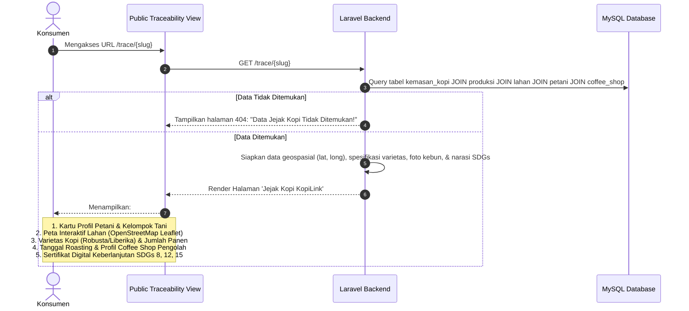

# PRODUCT REQUIREMENTS DOCUMENT (PRD)
## KopiLink: Sistem Traceability Kopi Berbasis SDGs untuk Transparansi dan Keberlanjutan

---

| Dokumen Informasi | Keterangan |
| :--- | :--- |
| **Nama Proyek** | **KopiLink** (*Coffee Supply Chain Traceability System*) |
| **Versi Dokumen** | 1.0 (Final Architecture & Technical PRD) |
| **Kategori Program** | Teknologi Hijau & Inovasi Berkelanjutan (Bumi Berseru Fest / BBF 2026) |
| **Target Mitra** | Kelompok Tani Pasak Piang (Robusta), Kelompok Tani Padi Jaya (Liberika), & *Coffee Shop* / *Roastery* Mitra |
| **Tech Stack Utama** | Laravel (PHP 8.2+), Docker (App + MySQL + phpMyAdmin), WhatsApp OTP API, Simple-QRCode, HTML5-QRCode Scanner |
| **Status Dokumen** | Approved for Development |

---

## 1. PENDAHULUAN & LATAR BELAKANG

### 1.1 Latar Belakang Masalah
Rantai pasok industri kopi di Indonesia sering kali panjang, berbelit, dan tidak transparan. Petani di tingkat hulu (seperti di Desa Pasak Piang dan Desa Padi Jaya) kerap berada pada posisi tawar rendah karena tidak memiliki pencatatan digital hasil panen dan tidak terhubung langsung dengan *coffee shop* (pembeli akhir). Di sisi hilir, konsumen dan *specialty coffee shop* semakin menuntut kepastian asal-usul biji kopi (*single-origin authentication*) serta bukti praktik pertanian ramah lingkungan yang bebas dari deforestasi.

### 1.2 Solusi: Sistem KopiLink
**KopiLink** adalah platform *web-based traceability* rantai pasok kopi dari **"Kebun ke Cangkir" (*Crop to Cup*)**. Sistem ini mengintegrasikan pencatatan data kebun, penyerahan hasil panen *green bean*, verifikasi penerimaan oleh *coffee shop*, serta penerbitan label kemasan ber-QR Code unik yang dapat dipindai langsung oleh konsumen tanpa perlu mengunduh aplikasi tambahan.

### 1.3 Keselarasan dengan Sustainable Development Goals (SDGs)
1. **SDG 8 (Decent Work and Economic Growth):** Memutus rantai tengkulak yang eksploitatif dan menciptakan transparansi transaksi demi kesejahteraan ekonomi petani lokal (*Fair Trade*).
2. **SDG 12 (Responsible Consumption and Production):** Menjamin pencatatan kuantitas *green bean* yang presisi guna mencegah manipulasi stok, pemalsuan asal-usul, dan *greenwashing*.
3. **SDG 15 (Life on Land):** Memetakan koordinat geospasial lahan (Latitude/Longitude) untuk memastikan budidaya kopi dilakukan di luar kawasan lindung dan mendukung kelestarian tutupan hutan agroforestri.

---

## 2. TUJUAN PRODUK & TARGET INDIKATOR (KPI)

### 2.1 Tujuan Utama
1. Menyediakan antarmuka ramah petani (*farmer-friendly UI*) dengan autentikasi nomor WhatsApp berbasis OTP yang mudah digunakan tanpa registrasi email yang rumit.
2. Mengotomatiskan validasi data (misal: penentuan jenis varietas kopi secara otomatis berdasarkan kelompok tani).
3. Mengoptimalkan performa transfer data dari area perkebunan melalui **kompresi gambar otomatis** sebelum disimpan ke peladen.
4. Menyediakan modul penerbitan dan pemindaian QR Code (kamera langsung & unggah gambar) untuk mengakses jejak digital kopi (*public traceability page*).

### 2.2 Target Program (Milestone BBF 2026)
* **Petani Terverifikasi:** Minimal 20 petani aktif dengan nomor WhatsApp terverifikasi (`is_verified = 1`).
* **Lahan Terdata:** Minimal 20 titik koordinat lahan terpetakan.
* **Volume Produksi:** Minimal 500 Kg *green bean* tercatat dalam siklus penyerahan.
* **Kemasan Ber-QR Code:** Minimal 100 kemasan berstiker QR Code beredar di pasar ritel/kafe mitra.

---

## 3. PENGGUNA SISTEM & PERAN (USER ROLES / RBAC)

| Peran Pengguna | Deskripsi Akses | Mekanisme Autentikasi |
| :--- | :--- | :--- |
| **Petani** | Menginput data lahan (koordinat, luas, populasi tanaman) dan data panen *green bean*. | Registrasi publik + Login (Username & Password) + **Verifikasi WhatsApp OTP** |
| **Coffee Shop** | Melihat daftar pasokan yang berstatus 'Tersedia', mengonfirmasi penerimaan biji kopi, dan menghasilkan label QR Code kemasan. | Login kredensial khusus yang diterbitkan oleh Admin Sistem (*Closed Access*) |
| **Konsumen** | Memindai QR Code pada kemasan kopi dan membaca riwayat jejak kopi (*traceability story*). | **Publik / Tamu (Tanpa Login)** |
| **Administrator** | Manajemen pengguna, seeding data *coffee shop*, monitoring integritas data, dan audit logs. | Login via panel admin / artisan CLI |

---

## 4. ATURAN BISNIS (BUSINESS RULES)

1. **Otomatisasi Varietas Kopi Berdasarkan Kelompok Tani:**
   - Jika Petani terdaftar di kelompok tani **`Pasak Piang`**, maka sistem otomatis menetapkan jenis kopi pada lahan sebagai **`Robusta`**.
   - Jika Petani terdaftar di kelompok tani **`Padi Jaya`**, maka sistem otomatis menetapkan jenis kopi pada lahan sebagai **`Liberika`**.
   - Petani tidak dapat mengubah jenis kopi secara manual untuk mencegah ketidakkonsistenan data geografis.
2. **Normalisasi Kontak WhatsApp:**
   - Kolom kontak disimpan sebagai tipe `BIGINT` untuk menjamin integritas digit numerik.
   - Sistem *backend* secara otomatis menormalisasi format lokal (misal: `0812xxxxxx`) menjadi format E.164 tanpa tanda plus (misal: `62812xxxxxx`).
3. **Keamanan & Masa Berlaku OTP:**
   - Kode OTP terdiri atas 4-6 digit numerik acak.
   - Masa aktif OTP dibatasi maksimum **5 menit** (`otp_expired_at`).
   - Akun petani baru berstatus `is_verified = 0` dan tidak diizinkan masuk (*login*) sebelum verifikasi kode OTP berhasil diselesaikan.
4. **Siklus Status Produksi (Traceability Lifecycle):**
   - Saat diinput oleh Petani, status produksi adalah **`Tersedia`**.
   - Saat *Coffee Shop* mengklaim biji kopi tersebut, status berubah menjadi **`Diterima Coffee Shop`**.
   - *Generate QR Code* hanya dapat dieksekusi terhadap data produksi yang telah berstatus `Diterima Coffee Shop`.
5. **Anti-Greenwashing & Keunikan QR:**
   - Setiap kemasan memiliki relasi ke satu entri produksi dan menerbitkan URL unik permanen (`qr_code_url`).
   - Link publik mengarah pada `/trace/{qr_code_slug}` yang bersifat *read-only* bagi konsumen.

---

## 5. SPESIFIKASI FITUR FUNGSIONAL (FUNCTIONAL REQUIREMENTS)

### 5.1 Modul Petani (Farmer Portal)
* **FR-FAR-01 (Registrasi Petani):** Formulir pendaftaran memuat username, password, nama lengkap, kontak WhatsApp, alamat, dan pilihan kelompok tani ('Pasak Piang' / 'Padi Jaya').
* **FR-FAR-02 (WhatsApp OTP Dispatch):** Sistem memicu pengiriman kode OTP via WhatsApp Gateway API sesaat setelah formulir pendaftaran berhasil divalidasi.
* **FR-FAR-03 (Aktivasi Akun OTP):** Formulir verifikasi OTP untuk mencocokkan kode; jika valid, status diubah menjadi `is_verified = 1`.
* **FR-FAR-04 (Autentikasi Login Petani):** Login menggunakan username dan password terenkripsi (`bcrypt/argon2id`). Petani dengan status belum diverifikasi diarahkan kembali ke layar OTP.
* **FR-FAR-05 (Manajemen Data Lahan):**
  - Input koordinat X (Longitude) dan koordinat Y (Latitude).
  - Input luas lahan (satuan Hektar) dan jumlah populasi pohon kopi.
  - Nilai jenis kopi diisi secara otomatis (*auto-computed backend*).
  - Upload foto kondisi kebun dengan **kompresi otomatis** (WebP/JPEG max 1200px, 75% quality).
* **FR-FAR-06 (Pencatatan Produksi Panen):**
  - Memilih kebun/lahan sumber panen.
  - Input jumlah panen *green bean* (satuan Kg) dan tanggal input.
  - Upload foto bukti biji kopi dengan kompresi gambar otomatis.
  - Status default tercatat sebagai `'Tersedia'`.

### 5.2 Modul Coffee Shop / Roastery (Buyer Portal)
* **FR-CS-01 (Autentikasi Terproteksi):** Kredensial *Coffee Shop* dikonfigurasi secara tertutup oleh sistem administrator.
* **FR-CS-02 (Katalog Pasokan Petani):** Melihat daftar hasil panen petani yang masih berstatus `'Tersedia'` beserta detail kelompok tani dan koordinatnya.
* **FR-CS-03 (Konfirmasi Penerimaan):** Melakukan aksi penerimaan biji kopi dengan mencatat perubahan status menjadi `'Diterima Coffee Shop'`.
* **FR-CS-04 (Generator QR Code Kemasan):**
  - Memicu pembuatan entri pada tabel `kemasan_kopi`.
  - Sistem meng-generate string unik / slug (misal: `KPL-ROB-2026-X89A1`).
  - Sistem memproduksi berkas grafis QR Code (format PNG/SVG beresolusi tinggi).
* **FR-CS-05 (Ekspor & Cetak Label QR):** Antarmuka pratinjau stiker kemasan dengan tombol *Download PNG* dan *Print Label Ready* (ukuran standar stiker 5x5 cm).

### 5.3 Modul Pemindaian & Halaman Traceability Konsumen (Consumer Experience)
* **FR-CON-01 (Pemindaian QR Kamera Langsung):** Membuka akses kamera perangkat (kamera belakang/webcam) secara responsif menggunakan HTML5 Scanner.
* **FR-CON-02 (Pemindaian QR dari Berkas Gambar):** Opsi *drag-and-drop* atau unggah gambar/tangkapan layar QR Code dari galeri ponsel.
* **FR-CON-03 (Halaman Jejak Kopi - Crop to Cup Page):**
  - **Identitas Petani:** Menampilkan nama, foto terkompresi, dan kelompok tani.
  - **Peta Lokasi Kebun:** Integrasi peta interaktif (Leaflet.js / OpenStreetMap) berdasarkan koordinat X dan Y.
  - **Spesifikasi Produk:** Menampilkan varietas kopi (Robusta / Liberika), luas lahan, dan tanggal panen.
  - **Profil Roastery:** Menampilkan identitas *Coffee Shop* pengolah biji kopi.
  - **SDGs Transparency Badge:** Infografis kontribusi terhadap pelestarian hutan dan perdagangan adil (*fair trade*).

---

## 6. ARSITEKTUR TEKNIS & PERANGKAT LUNAK

```
+-----------------------------------------------------------------------------------+
|                                 CLIENT DEVICES                                    |
|   [Petani (Mobile Web)]     [Coffee Shop (Desktop/Tablet)]     [Konsumen (Mobile)]|
+-----------------------------------------------------------------------------------+
                                         |  HTTPS / HTTP
                                         v
+-----------------------------------------------------------------------------------+
|                       DOCKER LOCAL ENVIRONMENT (CONTAINERS)                       |
|                                                                                   |
|  +-----------------------------------------------------------------------------+  |
|  | [Container: app] (Nginx / PHP 8.2-FPM Laravel 11)                           |  |
|  |  - Laravel Routing & RBAC Middleware                                        |  |
|  |  - WhatsApp Notification Service (HTTP Client -> WA Gateway API)            |  |
|  |  - Image Compression Pipeline (Intervention Image v3 / WebP Converter)      |  |
|  |  - QR Code Generation Service (Simple-QRCode / Endroid)                     |  |
|  |  - HTML5 QR Scanner Interface (Javascript Client Library)                   |  |
|  +-----------------------------------------------------------------------------+  |
|                                        |                                          |
|                                        | PDO MySQL (Port 3306)                     |
|                                        v                                          |
|  +-------------------------------------+   +-----------------------------------+  |
|  | [Container: db]                     |   | [Container: phpmyadmin]           |  |
|  | MySQL 8.0 Database                  |---| Web UI Admin Database             |  |
|  | Volume: mysql_data (Persistent)     |   | Port: 8080                        |  |
|  +-------------------------------------+   +-----------------------------------+  |
+-----------------------------------------------------------------------------------+
```

### 6.1 Backend: Laravel 11.x
* Arsitektur modular menggunakan pola **MVC (Model-View-Controller)** diperkuat dengan **Service Layer Pattern**:
  - `WhatsAppOtpService`: Mengelola pengacakan OTP, pengiriman HTTP ke gateway WhatsApp, validasi masa kedaluwarsa, dan hashing status.
  - `ImageOptimizationService`: Mengelola auto-resizing, kompresi JPEG/WebP, dan penghapusan EXIF metadata sensitif.
  - `QrCodeGeneratorService`: Membangun payload URL dan merender gambar QR vektor/bitmap.

### 6.2 Frontend: Blade + Vanilla CSS + Modern JS
* Desain visual elegan bertema *Earth-Tone Green & Specialty Coffee Palette* (#2C402E, #C89D65, #1A1A1A).
* Vanilla CSS responsif (*Mobile-First Design*) untuk memastikan kenyamanan akses petani di layar smartphone.
* Kompresi gambar sisi klien menggunakan HTML5 Canvas API sebelum pengunggahan data (menghemat kuota internet pedesaan).

### 6.3 Docker Compose Local Architecture
Peladen pengembangan lokal diisolasi penuh di dalam Docker:
* **Service `app`:** PHP 8.2 FPM + Nginx (atau PHP CLI Web Server untuk local artisan), terinstal ekstensi `pdo_mysql`, `gd`, `zip`, `bcmath`.
* **Service `db`:** MySQL 8.0 dengan *named volume* persisten agar data petani tidak hilang saat container direstart.
* **Service `phpmyadmin`:** Antarmuka visual web GUI untuk inspeksi tabel database pada port `8080`.

---

## 7. RANCANGAN DOCKER LOCAL DEVELOPMENT

Berikut adalah berkas spesifikasi `docker-compose.yml` untuk lingkungan lokal sistem KopiLink:

```yaml
version: '3.8'

services:
  # Laravel Application Container
  app:
    build:
      context: .
      dockerfile: Dockerfile
    container_name: kopilink_app
    restart: unless-stopped
    working_dir: /var/www
    volumes:
      - ./:/var/www
      - ./docker/php/local.ini:/usr/local/etc/php/conf.d/local.ini
    networks:
      - kopilink_network
    ports:
      - "8000:8000"
    environment:
      - APP_NAME=KopiLink
      - APP_ENV=local
      - APP_DEBUG=true
      - APP_URL=http://localhost:8000
      - DB_CONNECTION=mysql
      - DB_HOST=db
      - DB_PORT=3306
      - DB_DATABASE=kopilink_db
      - DB_USERNAME=kopilink_user
      - DB_PASSWORD=kopilink_secret
    depends_on:
      - db

  # MySQL Database Container
  db:
    image: mysql:8.0
    container_name: kopilink_db
    restart: unless-stopped
    ports:
      - "3306:3306"
    environment:
      MYSQL_DATABASE: kopilink_db
      MYSQL_USER: kopilink_user
      MYSQL_PASSWORD: kopilink_secret
      MYSQL_ROOT_PASSWORD: root_kopilink_secret
    volumes:
      - kopilink_mysql_data:/var/lib/mysql
    networks:
      - kopilink_network

  # phpMyAdmin Container
  phpmyadmin:
    image: phpmyadmin/phpmyadmin:latest
    container_name: kopilink_phpmyadmin
    restart: unless-stopped
    ports:
      - "8080:80"
    environment:
      PMA_HOST: db
      PMA_PORT: 3306
      MYSQL_ROOT_PASSWORD: root_kopilink_secret
    depends_on:
      - db
    networks:
      - kopilink_network

networks:
  kopilink_network:
    driver: bridge

volumes:
  kopilink_mysql_data:
    driver: local
```

---

## 8. STRUKTUR DATABASE LENGKAP (BERDASARKAN ERD V.4)

Struktur tabel di bawah ini merupakan implementasi database relasional yang telah divalidasi sesuai dengan rancangan [ERD Treacebility V.4.md](file:///c:/Users/dell/Documents/Project%20Web%20dan%20Aplikasi/treacebility_coffee/ERD/ERD%20Treacebility%20V.4.md):



### 8.1 Spesifikasi Detail Setiap Tabel

#### 1. Tabel: `petani`
Menyimpan profil, kredensial login, asal kelompok tani, dan status verifikasi WhatsApp OTP.
* `id_petani` : `INT UNSIGNED AUTO_INCREMENT PRIMARY KEY`
* `username` : `VARCHAR(50) UNIQUE NOT NULL`
* `password` : `VARCHAR(255) NOT NULL` (Hashed Bcrypt)
* `nama` : `VARCHAR(100) NOT NULL`
* `kontak` : `BIGINT UNSIGNED UNIQUE NOT NULL` *(Contoh: 6281234567890)*
* `alamat` : `TEXT NOT NULL`
* `kelompok_tani` : `ENUM('Pasak Piang', 'Padi Jaya') NOT NULL`
* `otp_code` : `VARCHAR(6) NULLABLE`
* `otp_expired_at` : `DATETIME NULLABLE`
* `is_verified` : `BOOLEAN DEFAULT 0 NOT NULL`
* `created_at`, `updated_at` : `TIMESTAMP`

#### 2. Tabel: `lahan`
Menyimpan data fisik kebun kopi, koordinat spasial, serta penetapan otomatis varietas kopi.
* `id_lahan` : `INT UNSIGNED AUTO_INCREMENT PRIMARY KEY`
* `id_petani` : `INT UNSIGNED NOT NULL` (*Foreign Key -> petani.id_petani ON DELETE CASCADE*)
* `koordinat_x` : `DECIMAL(11, 8) NOT NULL` *(Longitude / Garis Bujur)*
* `koordinat_y` : `DECIMAL(10, 8) NOT NULL` *(Latitude / Garis Lintang)*
* `luas_lahan` : `FLOAT NOT NULL` *(Dalam satuan Hektar)*
* `jumlah_tanaman` : `INT UNSIGNED NOT NULL`
* `jenis_kopi` : `ENUM('Robusta', 'Liberika') NOT NULL` *(Terisi otomatis oleh backend logic)*
* `foto_lahan` : `VARCHAR(255) NULLABLE` *(Path gambar hasil kompresi)*
* `created_at`, `updated_at` : `TIMESTAMP`

#### 3. Tabel: `produksi`
Menyimpan rekaman hasil panen *green bean* yang siap didistribusikan ke *Coffee Shop*.
* `id_produksi` : `INT UNSIGNED AUTO_INCREMENT PRIMARY KEY`
* `id_lahan` : `INT UNSIGNED NOT NULL` (*Foreign Key -> lahan.id_lahan ON DELETE CASCADE*)
* `jumlah_green_bean` : `FLOAT NOT NULL` *(Total panen dalam satuan Kg)*
* `tanggal_input` : `DATE NOT NULL`
* `status` : `ENUM('Tersedia', 'Diterima Coffee Shop') DEFAULT 'Tersedia' NOT NULL`
* `foto_green_bean` : `VARCHAR(255) NULLABLE` *(Path gambar hasil kompresi)*
* `created_at`, `updated_at` : `TIMESTAMP`

#### 4. Tabel: `coffee_shop`
Menyimpan profil dan kredensial login buyer (*Closed system / Dibuat oleh Admin*).
* `id_coffee_shop` : `INT UNSIGNED AUTO_INCREMENT PRIMARY KEY`
* `username` : `VARCHAR(50) UNIQUE NOT NULL`
* `password` : `VARCHAR(255) NOT NULL` (Hashed Bcrypt)
* `nama_toko` : `VARCHAR(100) NOT NULL`
* `created_at`, `updated_at` : `TIMESTAMP`

#### 5. Tabel: `kemasan_kopi`
Menyimpan data pengemasan biji kopi yang siap beredar di pasaran beserta link unik QR Code.
* `id_kemasan` : `INT UNSIGNED AUTO_INCREMENT PRIMARY KEY`
* `id_coffee_shop` : `INT UNSIGNED NOT NULL` (*Foreign Key -> coffee_shop.id_coffee_shop*)
* `id_produksi` : `INT UNSIGNED NOT NULL` (*Foreign Key -> produksi.id_produksi*)
* `qr_code_url` : `VARCHAR(255) UNIQUE NOT NULL` *(Link unik: https://kopilink.id/trace/{uuid})*
* `created_at`, `updated_at` : `TIMESTAMP`

---

## 9. CLASS DIAGRAM SISTEM (OBJECT-ORIENTED MODEL)

Rancangan kelas di bawah ini mencerminkan struktur pada [Class Diagram Treacebility.jfif](file:///c:/Users/dell/Documents/Project%20Web%20dan%20Aplikasi/treacebility_coffee/Class%20Diagram%20Treacebility.jfif):



---

## 10. ALUR KERJA SISTEM (ACTIVITY DIAGRAMS WALKTHROUGH)

Berikut adalah translasi komprehensif seluruh alur kerja dari direktori [Diagram Activity](file:///c:/Users/dell/Documents/Project%20Web%20dan%20Aplikasi/treacebility_coffee/Diagram%20Activity):

### 10.1 Alur 1: Pendaftaran Akun Petani & Verifikasi WhatsApp OTP


### 10.2 Alur 2: Login Akun Petani


### 10.3 Alur 3: Menginput Data Lahan & Kompresi Gambar


### 10.4 Alur 4: Menginput Data Produksi (Panen Green Bean)


### 10.5 Alur 5: Menerima Data Produksi oleh Coffee Shop


### 10.6 Alur 6: Melakukan Generate QR Code Kemasan


### 10.7 Alur 7: Pemindaian QR Code (Kamera Langsung & Berkas Gambar)


### 10.8 Alur 8: Melihat Halaman Traceability (Jejak Kopi Konsumen)


---

## 11. SPESIFIKASI MODUL TEKNIS KHUSUS

### 11.1 Integrasi WhatsApp OTP (Laravel WhatsApp Service)
Untuk pengiriman OTP ke nomor WhatsApp petani, sistem menggunakan integrasi REST API WhatsApp Gateway (contoh: Fonnte / Wablas / Twilio) yang dibungkus dalam Service Provider Laravel:

```php
namespace App\Services;

use Illuminate\Support\Facades\Http;
use App\Models\Petani;
use Carbon\Carbon;

class WhatsAppOtpService
{
    protected string $apiKey;
    protected string $endpoint;

    public function __construct()
    {
        $this->apiKey = config('services.whatsapp.api_key');
        $this->endpoint = config('services.whatsapp.endpoint', 'https://api.fonnte.com/send');
    }

    /**
     * Normalisasi nomor telepon ke format internasional (62xxxx)
     */
    public function formatPhoneNumber(string|int $phone): int
    {
        $cleaned = preg_replace('/[^0-9]/', '', (string)$phone);
        if (str_starts_with($cleaned, '0')) {
            $cleaned = '62' . substr($cleaned, 1);
        } elseif (!str_starts_with($cleaned, '62')) {
            $cleaned = '62' . $cleaned;
        }
        return (int)$cleaned;
    }

    /**
     * Generate dan kirim kode OTP
     */
    public function sendOtp(Petani $petani): bool
    {
        $otp = (string)random_int(100000, 999999);
        $expiredAt = Carbon::now()->addMinutes(5);

        $petani->update([
            'otp_code' => $otp,
            'otp_expired_at' => $expiredAt,
        ]);

        $message = "Halo {$petani->nama},\n\nKode verifikasi OTP akun KopiLink Anda adalah: *{$otp}*.\nKode ini berlaku selama 5 menit. Jangan bagikan kode ini kepada siapapun demi keamanan akun Anda.";

        $response = Http::withHeaders([
            'Authorization' => $this->apiKey,
        ])->post($this->endpoint, [
            'target' => (string)$petani->kontak,
            'message' => $message,
            'countryCode' => '62',
        ]);

        return $response->successful();
    }

    /**
     * Verifikasi kode OTP
     */
    public function verifyOtp(Petani $petani, string $inputOtp): bool
    {
        if (!$petani->otp_code || !$petani->otp_expired_at) {
            return false;
        }

        if (Carbon::now()->isAfter($petani->otp_expired_at)) {
            return false;
        }

        if ($petani->otp_code === trim($inputOtp)) {
            $petani->update([
                'is_verified' => 1,
                'otp_code' => null,
                'otp_expired_at' => null,
            ]);
            return true;
        }

        return false;
    }
}
```

### 11.2 Pipeline Kompresi Gambar (Client-Side & Server-Side)
Untuk mengantisipasi koneksi internet terbatas di wilayah perkebunan petani:

1. **Client-Side Pre-Compression (HTML5 Canvas in Blade):**
   Gambar berukuran besar (misal 5MB - 12MB dari kamera ponsel) langsung di-resize di browser menjadi maksimal lebar/tinggi 1280px dengan kualitas JPEG 75% sebelum dikirim ke server via form upload. Ukuran payload berkurang drastis menjadi < 350 KB.
2. **Server-Side Optimization (Intervention Image v3):**
   ```php
   namespace App\Services;

   use Intervention\Image\ImageManager;
   use Intervention\Image\Drivers\Gd\Driver;
   use Illuminate\Http\UploadedFile;
   use Illuminate\Support\Facades\Storage;
   use Illuminate\Support\Str;

   class ImageOptimizationService
   {
       protected ImageManager $manager;

       public function __construct()
       {
           $this->manager = new ImageManager(new Driver());
       }

       public function compressAndStore(UploadedFile $file, string $directory): string
       {
           $image = $this->manager->read($file->getRealPath());
           
           // Scale down down-to maximum 1200px width/height preserving aspect ratio
           $image->scaleDown(width: 1200, height: 1200);

           // Convert to modern WebP format with 75% quality
           $encoded = $image->toWebp(75);

           $filename = Str::uuid() . '.webp';
           $path = $directory . '/' . $filename;

           Storage::disk('public')->put($path, (string)$encoded);

           return $path;
       }
   }
   ```

### 11.3 Generator QR Code (Simple-QRCode Laravel)
* Package yang digunakan: `simplesoftwareio/simple-qrcode`.
* Format output: SVG (tajam saat dicetak dalam berbagai skala) dan PNG 300 DPI untuk label kemasan.
* Sintaks generate:
  ```php
  use SimpleSoftwareIO\QrCode\Facades\QrCode;

  $qrImage = QrCode::format('png')
      ->size(400)
      ->margin(2)
      ->errorCorrection('H')
      ->generate($traceUrl);
  ```

### 11.4 Scanner QR Code Interaktif (Kamera & Gambar)
Menggunakan library javascript `@zxing/library` atau `html5-qrcode` yang mendukung dua metode:
1. **Mode Live Video:** Mengakses `navigator.mediaDevices.getUserMedia` dengan kontrol kamera depan/belakang (*environment facing mode*).
2. **Mode File Input:** Mendukung input file `<input type="file" accept="image/*">` dengan metode `Html5Qrcode.scanFile(imageFile, false)`.

---

## 12. PERANCANGAN DATABASE SEEDER & MIGRATION

### 12.1 Logika Bisnis Otomasi Jenis Kopi pada Model/Observer
```php
namespace App\Observers;

use App\Models\Lahan;

class LahanObserver
{
    public function creating(Lahan $lahan): void
    {
        $petani = $lahan->petani;
        if ($petani) {
            if ($petani->kelompok_tani === 'Pasak Piang') {
                $lahan->jenis_kopi = 'Robusta';
            } elseif ($petani->kelompok_tani === 'Padi Jaya') {
                $lahan->jenis_kopi = 'Liberika';
            }
        }
    }
}
```

### 12.2 Seeder Default untuk Coffee Shop (Closed Authentication)
```php
namespace Database\Seeders;

use Illuminate\Database\Seeder;
use Illuminate\Support\Facades\Hash;
use App\Models\CoffeeShop;

class CoffeeShopSeeder extends Seeder
{
    public function run(): void
    {
        CoffeeShop::firstOrCreate(
            ['username' => 'roastery_senja'],
            [
                'password' => Hash::make('KopiLink2026!'),
                'nama_toko' => 'Senja Roastery & Cafe',
            ]
        );

        CoffeeShop::firstOrCreate(
            ['username' => 'biji_bumi_coffee'],
            [
                'password' => Hash::make('BumiHijau2026!'),
                'nama_toko' => 'Biji Bumi Specialty Coffee',
            ]
        );
    }
}
```

---

## 13. KEBUTUHAN NON-FUNGSIONAL (NON-FUNCTIONAL REQUIREMENTS / NFR)

| Kategori | Spesifikasi |
| :--- | :--- |
| **Performa** | Halaman publik *traceability* harus dapat dimuat di bawah **1.5 detik** pada jaringan 4G seluler. Ukuran aset gambar tidak boleh melebihi 250 KB setelah kompresi WebP. |
| **Keamanan** | - Enkripsi kata sandi dengan algoritma Bcrypt (cost factor >= 12).<br/>- Proteksi terhadap CSRF token pada seluruh request form HTTP.<br/>- Rate limiting pada endpoint pengiriman OTP (maksimal 3 kali permintaan per 15 menit per nomor kontak).<br/>- Sanitasi input koordinat latitude (-90 s/d 90) dan longitude (-180 s/d 180). |
| **Usabilitas (UI/UX)** | - Desain tombol berukuran besar (minimal tap target 48x48 px) dengan teks Bahasa Indonesia yang sederhana untuk memudahkan petani lanjut usia.<br/>- Notifikasi visual berwarna kontras saat status verifikasi berhasil atau gagal. |
| **Kompatibilitas** | Kompatibel dengan peramban seluler modern: Chrome Mobile, Safari iOS, Samsung Internet, dan Firefox Mobile. Fitur kamera scanner memerlukan koneksi HTTPS / `localhost` demi kepatuhan izin *camera security policy*. |
| **Ketersediaan (Reliability)** | Arsitektur kontainer Docker dirancang terisolasi; kegagalan pada container *phpMyAdmin* tidak mempengaruhi kinerja *app* atau *db*. |

---

## 14. TIMELINE PENGEMBANGAN & ESTIMASI ANGGARAN (BBF 2026)

### 14.1 Jadwal Sprint (6 Minggu Pelaksanaan)
* **Minggu 1 (Perencanaan & Setup):** Finalisasi PRD, inisialisasi repository, setup container Docker (Laravel, MySQL, phpMyAdmin), serta konfigurasi migrasi database.
* **Minggu 2 (Autentikasi & WhatsApp OTP):** Pembuatan portal Petani, implementasi gateway WhatsApp OTP, logic format nomor E.164, dan otentikasi Coffee Shop.
* **Minggu 3 (Modul Lahan, Produksi & Kompresi):** Fitur input koordinat lahan, otomatisasi varietas kopi, pipeline kompresi gambar (Client Canvas & Server Intervention Image).
* **Minggu 4 (Modul Coffee Shop & QR Generator):** Fitur penerimaan data pasokan, implementasi Simple-QRCode, penerbitan slug unik, dan fitur cetak label stiker.
* **Minggu 5 (Scanner & Halaman Traceability Publik):** Integrasi HTML5 QR Scanner (kamera langsung & unggah gambar), pembuatan halaman interaktif *Crop to Cup* dengan peta Leaflet.
* **Minggu 6 (UAT, Optimasi & Pelaporan):** Pengujian pengguna di lapangan bersama kelompok tani Pasak Piang & Padi Jaya, bug fixing, dan penyusunan laporan akhir program BBF 2026.

### 14.2 Alokasi Anggaran (Plafon Rp15.000.000)
1. **Infrastruktur & Layanan Cloud:** Rp4.000.000 (Cloud VPS/Hosting, domain .id, dan saldo lisensi WhatsApp API OTP).
2. **Pengembangan Aplikasi (Dev & UI/UX):** Rp6.500.000 (Desain UI/UX ramah petani, coding backend & frontend, integrasi QR pipeline).
3. **Sosialisasi & Onboarding Lapangan:** Rp3.000.000 (Akomodasi ke kebun petani mitra, konsumsi pelatihan, cetak stiker dummy QR Code).
4. **Dokumentasi & Administrasi:** Rp1.500.000 (Video dokumentasi dampak SDGs dan laporan pertanggungjawaban).

---

## 15. CHECKLIST PENGUJIAN & VALIDASI (ACCEPTANCE CRITERIA)

- [ ] Petani berhasil mendaftar dan menerima kode OTP ke nomor WhatsApp aktif dalam waktu < 10 detik.
- [ ] Petani tidak dapat login sebelum memasukkan kode OTP yang sah.
- [ ] Petani dari kelompok tani "Pasak Piang" secara otomatis menghasilkan jenis kopi "Robusta" saat menginput lahan.
- [ ] Petani dari kelompok tani "Padi Jaya" secara otomatis menghasilkan jenis kopi "Liberika" saat menginput lahan.
- [ ] File foto lahan dan produksi yang diunggah berukuran asli > 3MB otomatis terkompresi menjadi < 300KB dengan format `.webp`.
- [ ] *Coffee Shop* dapat melihat daftar produksi berstatus "Tersedia" dan mengubah statusnya menjadi "Diterima Coffee Shop".
- [ ] Tombol *Generate QR Code* menghasilkan gambar QR Code yang valid dan mengarah ke URL traceability unik.
- [ ] Kamera ponsel konsumen dapat langsung membaca QR Code dan membuka halaman traceability tanpa login.
- [ ] Scanner dapat membaca QR Code dari berkas tangkapan layar/gambar yang diunggah melalui tombol file upload.
- [ ] Halaman traceability menampilkan profil petani, titik koordinat peta kebun yang akurat, varietas kopi, tanggal panen, dan nama toko *Coffee Shop*.
